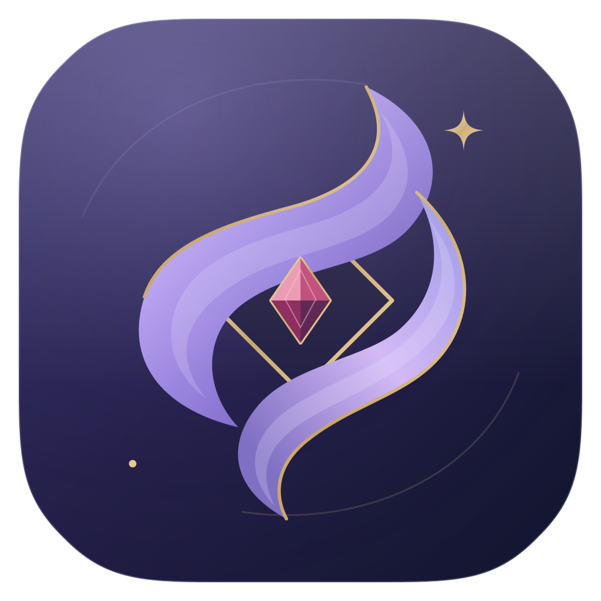
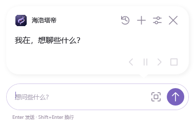
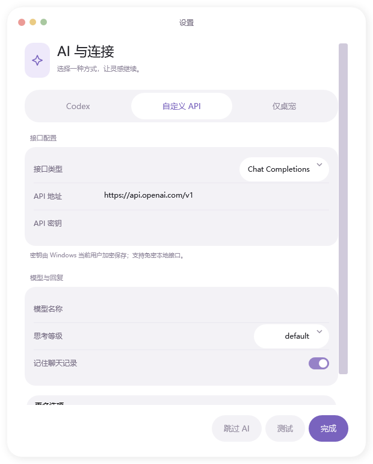

<p align="center">
  
</p>

# 海洛塔帝桌宠

一只住在 Windows 桌面上的海洛塔帝：可以点击互动、拖动、在头顶气泡中聊天，也可以框选屏幕的一部分向 AI 提问。

0.5.0 使用轻量的扁平胶囊界面：白色气泡、紫色发送按钮、线条图标和浅色分组设置。界面直接使用原生 WPF 渲染，无需 WebView。

<p align="center"></p>

[](https://github.com/FeatherCloudSky/Hailuotadidesktop/releases)
[](LICENSE)
[](https://github.com/FeatherCloudSky/Hailuotadidesktop/actions/workflows/build.yml)

## 下载与安装

前往 **[Releases 下载最新版](https://github.com/FeatherCloudSky/Hailuotadidesktop/releases/latest)**，下载 `Hailuotadi-Setup-x64.exe`，双击后点击“一键安装”。也提供免安装的便携 ZIP。

- 支持 Windows 10 / 11 x64，使用系统的 .NET Framework 4.8；无需 Python 或 Node.js。
- 安装到当前用户目录，无需管理员权限，自动创建桌面、开始菜单快捷方式及卸载入口。
- 首次单击桌宠时会询问是否已安装 Codex 桌面端或 CLI，并检查常见位置；可连接本机已有的 Codex 登录。
- 没有 Codex 时可以填写自己的 API，也可以直接跳过。跳过后保留桌宠互动，不启用 AI 对话。
- 安装包不包含 Codex、账号、API Key 或个人聊天记录。换电脑后使用那台电脑自己的 Codex 登录或 API。

## 功能与操作

| 操作 | 效果 |
| --- | --- |
| 单击角色 | 打开头顶气泡及下方输入框 |
| 按住 / 拖动 | 按下反馈、切换姿态、移动位置 |
| 鼠标滚轮 | 调整大小，保存位置和缩放 |
| Enter / Shift+Enter | 发送 / 换行 |
| 截图 | 框选屏幕区域，预览后随问题发送；Esc 或右键取消框选 |
| 点到气泡外 / 拖动角色 | 收起气泡 |
| 右键角色 / 托盘菜单 | AI 设置、隐藏、找回、退出 |

气泡平时隐藏。发送后显示“海洛塔帝正在深度思考中......”，回复按标点分段播放；可以暂停、前后翻阅或查看完整记录。最后一段读完后自动收起，鼠标停留在气泡上时暂时保留。

### AI 连接

支持已安装的 **Codex**、OpenAI 兼容 **Chat Completions** 和 **Responses** 接口。设置中可填写 API 地址、密钥、模型 ID、思考等级、超时、Token 上限、Temperature 和角色提示词。参数是否可用取决于供应商和所选模型；截图问答需要模型支持图片输入。

默认角色提示词见 [默认提示词.txt](默认提示词.txt)。AI 仅用于对话，Codex 请求使用独立聊天目录并禁用命令执行工具。

### 数据与隐私

- 设置及可选的聊天记录保存在 `%APPDATA%\HailuotaPet`；API Key 使用当前 Windows 用户的 DPAPI 加密，换电脑后需重新填写。
- 截图只有点击“发送”后才会随问题传给所选 AI 服务。仅发送框选区域，不发送整张桌面。
- 截图不会写入聊天记录；Codex 图片输入会产生临时文件，请求结束后清理。当前会话内可保留最近截图供后续提问，发送下一条问题后释放旧图。
- 升级保留设置和聊天记录，卸载默认也保留。更多操作见 [用户指南](用户指南.md)。

## 从源码构建

### 运行程序

在 Windows x64 上使用 Windows PowerShell 或 PowerShell 7，安装/启用 .NET Framework 4.8。工程使用系统 C# 编译器和 WPF，不需要 Visual Studio 或 NuGet。

```powershell
git clone https://github.com/FeatherCloudSky/Hailuotadidesktop.git
cd Hailuotadidesktop
powershell -NoProfile -ExecutionPolicy Bypass -File .\src\build.ps1
.\启动桌宠.cmd
```

### 生成安装包和便携版

打包额外需要 Python 3（仅用标准库），预先生成好的角色图片和图标已包含在仓库里。

```powershell
powershell -NoProfile -ExecutionPolicy Bypass -File .\src\release.ps1
# Python 不在 PATH 时，给出可执行文件路径：
powershell -NoProfile -ExecutionPolicy Bypass -File .\src\release.ps1 -PythonExecutable C:\Python312\python.exe
```

产物写入 `dist/`：一键安装 EXE、便携 ZIP、`SHA256SUMS.txt`。安装包仅含运行所需文件，不打包开发机配置。GitHub Actions 在 Windows 上执行构建和本地检查，推送 `v*` 标签时发布 Release。

### 检查

```powershell
$app = Start-Process .\海洛塔帝桌宠.exe -ArgumentList '--self-test' -PassThru
$app.WaitForExit()
$app.ExitCode
$app = Start-Process .\海洛塔帝桌宠.exe -ArgumentList '--chat-self-test' -PassThru
$app.WaitForExit()
$app.ExitCode
```

检查结果位于 `checks/`，使用独立测试目录，不覆盖个人设置。覆盖点击/拖动、透明素材、气泡布局与收起、标点分段、截图裁剪、图片请求格式、模拟 HTTP/SSE、取消请求、密钥加密等。原生胶囊界面还会执行携带合成截图的发送与回复测试，并检查设置字段往返、接口选择和聊天记录开关。

独立的 [HTML 设计预览](ui-preview/index.html) 可从本地浏览器打开；保持它与 `assets/` 的相对路径即可。预览中的回复和框选画面都是示例，不会连接真实 AI 或读取桌面。

`--backend-smoke-test` 会使用本机 Codex 登录，把**合成测试图**发送给 AI 验证看图，需要联网并可能产生服务用量，不在 CI 中运行。0.5.0 已在本机通过真实 Codex 合成图片读图和临时文件清理检查；气泡携图发送另通过模拟 API 集成检查。自定义 API 的真实服务需按供应商配置验证。多显示器、不同缩放比例仍建议在实际设备检查。

## 项目结构

```text
assets/                 透明角色素材、SVG 图标、Windows 图标
src/Pet.cs              桌宠窗口、鼠标交互、托盘与位置保存
src/BubbleChat.cs       气泡输入、分段回复、截图预览
src/ScreenCapture.cs    屏幕框选与图片裁剪
src/Ai.cs               Codex / API 连接、配置与聊天记录
src/ChatUi.cs           首次使用引导、AI 设置
src/AiChecks.cs         本地模拟及可选联网检查
src/Setup.cs            当前用户安装器与卸载器
src/release.ps1         构建、检查和打包入口
```

素材处理脚本是可选开发工具：`prepare_assets.py` / `clean_assets.py` / `prepare_logo.py` 需要 Pillow，`render_logo.cjs` 需要 Node.js 和 sharp。普通构建不运行这些脚本。SVG 为图标的可编辑源文件。

## 贡献与反馈

欢迎提交 Issue 或 Pull Request。反馈连接问题时，请说明 Windows 版本、连接类型、模型及脱敏错误；不要上传 API Key、账号凭据、个人聊天记录或私人截图。开发约定见 [CONTRIBUTING.md](CONTRIBUTING.md)，版本变化见 [CHANGELOG.md](CHANGELOG.md)。

## 许可证

本项目代码使用 [MIT License](LICENSE)。角色形象等第三方权利不因 MIT 许可而转让，详见 [NOTICE.md](NOTICE.md)。本项目为非官方工具。
